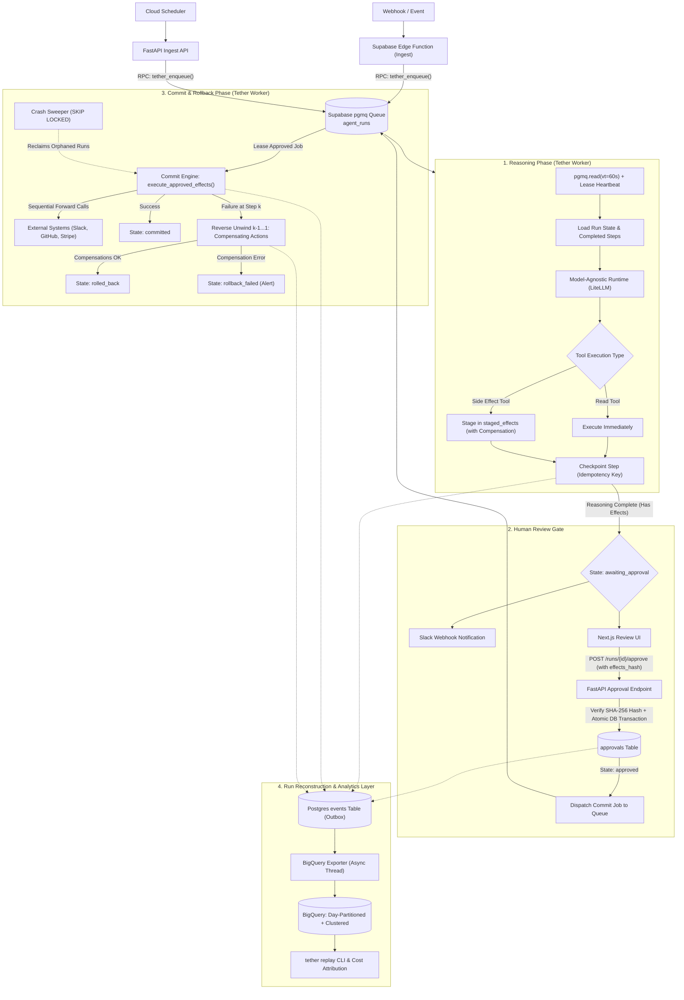

# Tether: Event-Driven Agent Runtime

> **A durable, event-triggered, model-agnostic agent runtime on Supabase and GCP with a human review gate, atomic rollback, and full run reconstruction.**

[](https://github.com/Harsh-karn/Event-Driven-Agent-Runtime-with-Human-Review-Gate-and-Atomic-Rollback/actions)
[](LICENSE)
[](https://www.python.org/downloads/)
[](https://supabase.com)
[](https://cloud.google.com/run)

---

## 1. The Core Guarantee

> *"Kill the worker mid-run and the run resumes without duplicating a single side effect, and I can replay exactly what the agent saw and decided from the warehouse."*

Autonomous LLM agents fail in production when they:
1. **Duplicate real-world side effects** on transient network retries or worker restarts.
2. **Execute destructive or sensitive actions** without explicit human sign-off.
3. **Leave external third-party systems half-mutated** when an API call fails halfway through a plan.
4. **Lose decision context**, making it impossible to reconstruct *why* an LLM chose a specific tool.

**Tether solves this at the runtime layer:**
- **Durable Checkpoints**: State is persisted in PostgreSQL after every model call, decision, and tool step. Retries reuse completed steps by deterministic idempotency key `sha256(run_id + idx + input_hash)`.
- **Side Effect Quarantining**: Mutations (`is_effect=True`) are staged with compensating actions, never directly executed during agent reasoning.
- **Cryptographic Human Review Gate**: Mutations are approved only when the human signature matches a canonical SHA-256 hash of all staged parameters.
- **Distributed Commit Engine**: Approval asynchronously enqueues a commit job; workers lease and execute mutations under heartbeat protection.
- **Compensation-Based Atomic Rollback**: If effect $k$ fails during execution, effects $k-1 \dots 1$ are automatically unwound in reverse order.
- **Automated Crash Recovery Sweeper**: Background recovery discovers runs orphaned mid-commit or mid-rollback via `SELECT ... FOR UPDATE SKIP LOCKED` and resumes execution.
- **Warehouse Outbox Logging**: Structured events stream asynchronously to BigQuery with server-side deduplication (`row_ids`) and automated PII secret redaction.

---

## 2. Architecture & Execution Lifecycle



---

## 3. Distributed Reliability & Invariants

| Reliability Boundary | Implementation Mechanism | Failure Mode Prevented |
| :--- | :--- | :--- |
| **Ingress Deduplication** | `tether_enqueue()` stored procedure with `EXCEPTION WHEN unique_violation` | Prevents duplicate run creation and HTTP 500 races under concurrent webhook deliveries. |
| **Fail-Closed Security** | Deno Edge Function requires `WEBHOOK_SECRET` and validates HMAC-SHA256 signature | Prevents unauthenticated request injection when environment secrets are missing. |
| **Reviewer Authentication** | FastAPI dependency `verify_reviewer_auth` validates `REVIEW_API_KEY` via `hmac.compare_digest` | Prevents unauthorized operator approval spoofing and privilege escalation. |
| **Review Hash Integrity** | SHA-256 canonical hash across `idx:target:action:params:compensation` verified before commit | Rejects execution if staged effects or parameters were altered post-review. |
| **Review-to-Commit Bridge** | `approve_run()` dispatches execution job to `agent_runs` queue for worker pickup | Prevents approved runs from becoming orphaned or indefinitely suspended. |
| **Non-Atomic Review Guard** | `record_approval_and_transition()` executes row lock, upsert, and state update in 1 transaction | Eliminates orphaned approval records and race conditions with expiry sweeper. |
| **Crash Recovery Sweeper** | Worker scans `runs WHERE state IN ('committing', 'rolling_back') FOR UPDATE SKIP LOCKED` | Guarantees recovery from worker host death (`kill -9`) mid-commit or mid-rollback. |
| **Warehouse Deduplication** | BigQuery streaming inserts pass event UUIDs as `row_ids` inside `asyncio.to_thread` | Prevents event duplication in analytics warehouse upon exporter restarts or retries. |

---

## 4. Tech Stack

| Layer | Tool | Purpose |
| :--- | :--- | :--- |
| **Language & Engine** | Python 3.12+, FastAPI, Pydantic v2, psycopg 3 | Strict static typing, async I/O, native PostgreSQL connection pooling |
| **Queue** | Supabase Queues (`pgmq`) on PostgreSQL | Visibility timeouts, lease extensions, dead-letter archiving |
| **Ingest** | Supabase Edge Function (Deno/TypeScript) | Fast, edge-proximate webhook validation and deduplication |
| **Schedules** | GCP Cloud Scheduler | Periodic cron triggers invoking the enqueue API |
| **Compute** | GCP Cloud Run (Worker & API) | Containerized execution scaling down to zero |
| **Model Layer** | LiteLLM behind abstract `Runtime` protocol | Model-agnostic completions, provider fallback, token telemetry |
| **Warehouse** | Google BigQuery | Day-partitioned, clustered storage for run logs and cost analytics |
| **Review UI** | Next.js with Supabase Auth & Tailwind CSS | Real-time human gate with cryptographic effect validation |
| **Secrets & IaC** | GCP Secret Manager & Terraform | Zero hardcoded credentials, fully automated infrastructure |

---

## 5. Repository Structure

```text
.
├── Dockerfile                  # Cloud Run multi-stage Docker container
├── pyproject.toml              # Python project metadata and dependencies
├── .env.example                # Template environment variables
├── .github/workflows/
│   └── ci.yml                  # GitHub Actions CI with live PostgreSQL 15 & migrations
├── docs/
│   ├── adr/                    # Architecture Decision Records
│   │   ├── 001-own-loop-vs-framework.md
│   │   ├── 002-queue-selection-pgmq.md
│   │   ├── 003-atomic-rollback-model.md
│   │   └── 004-outbox-event-streaming.md
│   └── project_roadmap.md      # Full 9-phase execution blueprint
├── infra/                      # Terraform: Cloud Run, BigQuery, IAM, Secrets, Scheduler
├── supabase/
│   ├── migrations/             # SQL schema, pgmq queues, RLS policies
│   └── functions/ingest/       # Deno TypeScript Webhook Edge Function
├── src/tether/
│   ├── api.py                  # FastAPI enqueue, health, and reviewer auth service
│   ├── worker.py               # Polling loop, lease heartbeat, commit dispatcher, DLQ
│   ├── engine.py               # Deterministic step engine & finite state machine
│   ├── effects.py              # Staging, execution, and compensation rollback
│   ├── gate.py                 # Human review gate, hash verification, queue dispatch
│   ├── cost.py                 # Model pricing tables and step cost calculator
│   ├── events.py               # Outbox event publisher and PII redaction
│   ├── export.py               # PostgreSQL outbox to BigQuery batch loader
│   ├── replay.py               # Warehouse-only run reconstruction CLI
│   ├── runtime/                # LiteLLM adapter and abstract Runtime protocol
│   └── agents/                 # Agent interfaces and triage/digest implementation
├── review-ui/                  # Next.js human approval dashboard
└── tests/
    ├── unit/                   # State machine, hashing, worker, gate, and api tests
    ├── integration/            # Postgres and queue integration tests
    └── chaos/                  # Worker kill -9, commit crash, DLQ, and retry tests
```

---

## 6. Quickstart

### Prerequisites
- Python 3.12+ (or `uv`)
- Docker & Docker Compose
- Supabase Project (PostgreSQL 15+ with `pgmq`) or local PostgreSQL

### Local Development Setup
```bash
# Clone the repository
git clone https://github.com/Harsh-karn/Event-Driven-Agent-Runtime-with-Human-Review-Gate-and-Atomic-Rollback.git
cd Event-Driven-Agent-Runtime-with-Human-Review-Gate-and-Atomic-Rollback

# Install dependencies with uv
uv pip install -e ".[dev]"

# Copy environment variables
cp .env.example .env

# Run database migrations
psql $DATABASE_URL -f supabase/migrations/001_initial_schema.sql

# Start the API server
python -m tether.cli api --port 8000

# In a separate terminal, start the worker
python -m tether.cli worker

# In a separate terminal, launch the Next.js Review UI
cd review-ui && npm install && npm run dev
```

---

## 7. Warehouse Replay CLI

Reconstruct the full timeline of any execution run exclusively from BigQuery warehouse event logs:

```bash
# Replay full audit timeline of an agent run
tether replay 3c914bf1-08fa-4e78-9580-ff29ad123b08

# Compare and diff two runs of the same agent
tether replay 3c914bf1-08fa-4e78-9580-ff29ad123b08 --diff e4a19b22-81cd-4bc0-9d33-728b9d10e8f1
```

---

## 8. Automated Test Suite (55 Passing Tests)

Run the full unit, integration, and chaos test suite:

```bash
uv run pytest tests/ -v
```

```text
tests/chaos/test_chaos_recovery.py::test_chaos_worker_kill_mid_run_and_resumption PASSED
tests/chaos/test_chaos_recovery.py::test_chaos_commit_crash_triggers_reverse_compensation PASSED
tests/chaos/test_chaos_recovery.py::test_chaos_poison_message_moves_to_dead_letter_queue PASSED
tests/chaos/test_chaos_recovery.py::test_chaos_stale_approval_timeout_expiration PASSED
tests/unit/test_worker.py::test_worker_approved_run_invokes_commit_engine PASSED
tests/unit/test_worker.py::test_worker_recovers_stale_in_flight_runs PASSED
tests/unit/test_api.py::test_approve_endpoint_requires_auth_when_configured PASSED
tests/integration/test_webhook_and_tamper.py::test_webhook_deduplication_exact_event_redelivery PASSED
tests/integration/test_webhook_and_tamper.py::test_tampered_staged_effects_commit_refused PASSED
tests/integration/test_webhook_and_tamper.py::test_human_reviewer_rejection_zero_effects_committed PASSED
... (45 unit tests across runtime, state machine, gate, and export)
======================== 55 passed, 3 warnings in 7.39s ========================
```

---

## 9. Chaos Testing Guarantees

| Chaos Scenario | Expected Behavior | Implementation & Recovery Mechanism |
| :--- | :--- | :--- |
| **`kill -9` worker mid-reasoning** | Visibility lease expires; secondary worker claims job; zero duplicate side effects. | Steps replayed from `steps` checkpoints; model queries only for unexecuted steps. |
| **Duplicate webhook delivery** | Exact event redelivery returns 200 OK with existing run ID without duplicating execution. | SQL `tether_enqueue()` stored procedure with `EXCEPTION WHEN unique_violation`. |
| **Model provider timeout** | Automatic fallback to secondary candidate model with exponential backoff. | `LiteLLMRuntime` candidate list iteration with latency & token cost tracking. |
| **Reviewer rejects run** | Zero side effects committed; run marked `rejected`. | `ReviewGate.reject_run()` terminates run immediately without dispatching commit job. |
| **Effects altered post-approval** | Cryptographic `effects_hash` mismatch halts commit immediately. | Pre-commit SHA-256 hash assertion refuses execution on tampering. |
| **Worker crash mid-commit (step $k$)** | Compensations for steps $k-1 \dots 1$ execute in reverse order; run marked `rolled_back`. | Reverse Saga unwinding with `comp_handler` execution; fallback to `ROLLBACK_FAILED` if compensation errors. |
| **Worker host death during commit** | Secondary worker discovers abandoned run and resumes forward commit or rollback. | `TetherWorker.recover_stale_in_flight_runs()` using `SELECT ... FOR UPDATE SKIP LOCKED`. |
| **Poison message / repeated error** | Exponential backoff up to max attempts, then archived to Dead-Letter Queue (`DLQ`). | PGMQ `read_ct` check with automatic transition to `RunState.DEAD_LETTERED`. |

---

## 10. License

MIT License. See [LICENSE](LICENSE) for details.
