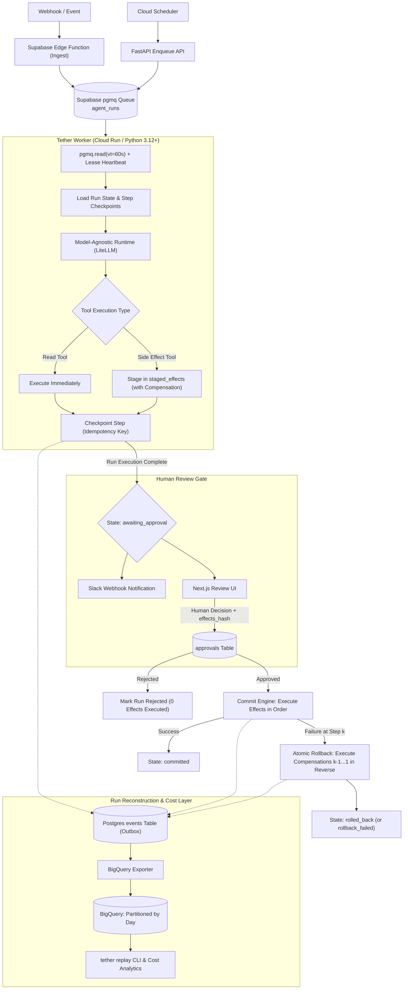

# Tether: Event-Driven Agent Runtime

> **A durable, event-triggered, model-agnostic agent runtime on Supabase and GCP with a human review gate, atomic rollback, and full run reconstruction.**

[](https://github.com/Harsh-karn/Event-Driven-Agent-Runtime-with-Human-Review-Gate-and-Atomic-Rollback/actions)
[](LICENSE)
[](https://www.python.org/downloads/)
[](https://supabase.com)
[](https://cloud.google.com/run)

---

## 1. The Core Guarantee

> *"Kill the worker mid-run and the run resumes without duplicating a single side effect, and I can replay exactly what the agent saw and decided from the warehouse."*

Autonomous LLM agents fail in production when they:
1. **Duplicate real-world side effects** on transient network retries or worker restarts.
2. **Execute destructive or sensitive actions** without explicit human sign-off.
3. **Leave external third-party systems half-mutated** when an API call fails halfway through a plan.
4. **Lose decision context**, making it impossible to reconstruct *why* an LLM chose a specific tool.

**Tether solves this at the runtime layer:**
- **Durable Checkpoints**: State is stored in Postgres after every model call, decision, and tool step. Retries reuse completed steps by idempotency key.
- **Side Effect Staging**: Side effects are *staged*, never directly executed during agent reasoning.
- **Cryptographic Human Review Gate**: Effects are committed only after human approval matches the cryptographic `effects_hash`.
- **Compensation-Based Atomic Rollback**: If effect $k$ fails during execution, effects $k-1 \dots 1$ are automatically unwound in reverse.
- **Warehouse Outbox Logging**: Structured events stream to BigQuery, enabling deterministic run reconstruction and token/cost attribution.

---

## 2. Architecture



---

## 3. Tech Stack

| Layer | Tool | Purpose |
| :--- | :--- | :--- |
| **Language** | Python 3.12+, FastAPI, Pydantic v2, psycopg 3 | Strict typing, async I/O, native PostgreSQL connection pooling |
| **Queue** | Supabase Queues (`pgmq`) on PostgreSQL | Visibility timeouts, lease extensions, dead-letter archiving |
| **Ingest** | Supabase Edge Function (Deno/TypeScript) | Fast, edge-proximate webhook validation and deduplication |
| **Schedules** | GCP Cloud Scheduler | Periodic cron triggers invoking the enqueue API |
| **Compute** | GCP Cloud Run (Worker & API) | Containerized execution scaling down to zero |
| **Model Layer** | LiteLLM behind abstract `Runtime` protocol | Model-agnostic completions, provider fallback, token telemetry |
| **Warehouse** | Google BigQuery | Day-partitioned, clustered storage for run logs and cost analytics |
| **Review UI** | Next.js with Supabase Auth & Tailwind CSS | Real-time human gate with cryptographic effect validation |
| **Secrets & IaC** | GCP Secret Manager & Terraform | Zero hardcoded credentials, fully automated infrastructure |

---

## 4. Repository Structure

```text
.
├── Dockerfile                  # Cloud Run multi-stage Docker container
├── pyproject.toml              # Python project metadata and dependencies
├── .env.example                # Template environment variables
├── docs/
│   ├── adr/                    # Architecture Decision Records
│   │   ├── 001-own-loop-vs-framework.md
│   │   ├── 002-queue-selection-pgmq.md
│   │   ├── 003-atomic-rollback-model.md
│   │   └── 004-outbox-event-streaming.md
│   └── project_roadmap.md      # Full 9-phase execution blueprint
├── infra/                      # Terraform: Cloud Run, BigQuery, IAM, Secrets, Scheduler
├── supabase/
│   ├── migrations/             # SQL schema, pgmq queues, RLS policies
│   └── functions/ingest/       # Deno TypeScript Webhook Edge Function
├── src/tether/
│   ├── api.py                  # FastAPI enqueue and health service
│   ├── worker.py               # Polling loop, lease heartbeat, DLQ routing
│   ├── engine.py               # Deterministic step engine & finite state machine
│   ├── effects.py              # Staging, execution, and compensation rollback
│   ├── gate.py                 # Human review gate & hash verification
│   ├── cost.py                 # Model pricing tables and step cost calculator
│   ├── events.py               # Outbox event publisher and PII redaction
│   ├── export.py               # PostgreSQL outbox to BigQuery batch loader
│   ├── replay.py               # Warehouse-only run reconstruction CLI
│   ├── runtime/                # LiteLLM adapter and abstract Runtime protocol
│   └── agents/                 # Agent interfaces and triage/digest implementation
├── review-ui/                  # Next.js human approval dashboard
└── tests/
    ├── unit/                   # State machine, hashing, and parser tests
    ├── integration/            # Postgres and queue integration tests
    └── chaos/                  # Worker kill -9, commit crash, and retry tests
```

---

## 5. Quickstart

### Prerequisites
- Python 3.12+ (or `uv`)
- Docker & Docker Compose
- Supabase Project (PostgreSQL 15+ with `pgmq`) or local PostgreSQL

### Local Development Setup
```bash
# Clone the repository
git clone https://github.com/Harsh-karn/Event-Driven-Agent-Runtime-with-Human-Review-Gate-and-Atomic-Rollback.git
cd Event-Driven-Agent-Runtime-with-Human-Review-Gate-and-Atomic-Rollback

# Install dependencies with uv or pip
uv pip install -e ".[dev]"

# Copy environment variables
cp .env.example .env

# Run database migrations
psql $DATABASE_URL -f supabase/migrations/001_initial_schema.sql

# Start the API server
python -m tether.cli api --port 8000

# In a separate terminal, start the worker
python -m tether.cli worker
```

---

## 6. Chaos Testing Guarantees

| Chaos Scenario | Expected Behavior |
| :--- | :--- |
| **`kill -9` worker mid-run** | Visibility lease expires; secondary worker resumes from last completed step; zero duplicate side effects. |
| **Duplicate webhook delivery** | Idempotency key prevents second run insertion. |
| **Model provider timeout** | Automatic fallback to secondary model with exponential backoff. |
| **Reviewer rejects run** | Zero side effects committed; run marked `rejected`. |
| **Effects altered post-approval** | Cryptographic `effects_hash` mismatch halts commit immediately. |
| **Worker crash mid-commit (step $k$)** | Compensations for steps $k-1 \dots 1$ execute in reverse order; run marked `rolled_back`. |
| **Poison message / repeated error** | Exponential backoff up to max attempts, then archived to Dead-Letter Queue (`DLQ`). |

---

## 7. License

MIT License. See [LICENSE](LICENSE) for details.
