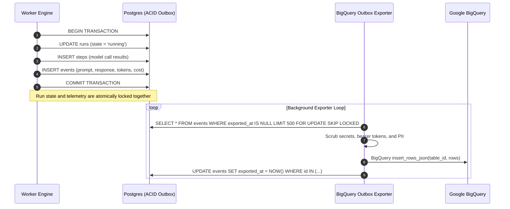

# ADR 004: Transactional Outbox Pattern for Run Reconstruction and Warehouse Observability

- **Status**: Accepted
- **Deciders**: Harsh Karn, Architecture & Runtime Team
- **Date**: 2026-10-17
- **Technical Area**: Observability / Data Warehouse / Audit Trail / Cost Attribution

---

## Context & Problem Statement

Production agent systems require exhaustive operational visibility:
1. **100% Deterministic Run Reconstruction**: We must be able to replay *exactly* what the model saw, what it reasoned, which tools it invoked, the raw parameters it supplied, and who approved the execution.
2. **Crash Resilience**: If a worker crashes (`kill -9`) mid-execution, telemetry must not be lost or decoupled from the database state.
3. **Cost & Token Attribution**: Tokens (prompt and completion) and USD financial cost must be tracked per step and aggregated per run, agent, and tenant.
4. **Security & Privacy**: Secrets, API keys, authentication headers, and personal identifiable information (PII) must be scrubbed before hitting analytical data stores.

---

## The Pitfall of Direct-to-Warehouse Logging

A naive implementation streams log events directly from the worker to BigQuery via HTTP APIs. This introduces fatal failure modes:
- **The Dual-Write Race**: If the worker writes state to PostgreSQL but crashes before the HTTP POST to BigQuery succeeds, the event log is permanently lost while the state remains committed.
- **Latency & Timeout Contention**: Synchronously awaiting analytical warehouse ingestion on every agent step degrades loop latency and ties execution throughput to warehouse API availability.
- **Out-of-Order Delivery**: Concurrent HTTP requests to an external API can land out of order, corrupting the reconstruction timeline.

---

## The Tether Solution: Transactional Outbox to BigQuery

To provide ironclad reconstruction guarantees, Tether implements the **Transactional Outbox Pattern**:



### 1. Atomic Outbox Storage
Events are stored in a dedicated `events` table in PostgreSQL:
```sql
CREATE TABLE events (
    id UUID PRIMARY KEY DEFAULT gen_random_uuid(),
    run_id UUID NOT NULL REFERENCES runs(id) ON DELETE CASCADE,
    step_id UUID REFERENCES steps(id) ON DELETE SET NULL,
    ts TIMESTAMPTZ NOT NULL DEFAULT NOW(),
    type VARCHAR(50) NOT NULL, -- model_call, tool_call, state_transition, approval, compensation
    payload JSONB NOT NULL,
    tokens_in INTEGER DEFAULT 0,
    tokens_out INTEGER DEFAULT 0,
    cost_usd NUMERIC(10, 6) DEFAULT 0.000000,
    model VARCHAR(100),
    exported_at TIMESTAMPTZ
);
```
Because the `INSERT INTO events` statement executes within the exact same database transaction as the step checkpoint and state update, **it is impossible for a state transition to occur without its corresponding telemetry being recorded**.

### 2. Analytical Optimization in BigQuery
The BigQuery analytics warehouse is configured for optimal analytical performance:
- **Partitioning**: Partitioned by day on `DATE(ts)` to ensure queries for recent runs avoid full-table scans.
- **Clustering**: Clustered by `run_id` and `agent_id` for instant timeline lookups and per-agent cost rollups.

### 3. PII & Secret Redaction Engine
Prior to warehouse streaming, all event payloads pass through an automated redaction sanitizer:
- Patterns matching Bearer tokens, API keys (`sk-...`, `ghp_...`, `AIza...`), and database passwords are substituted with `[REDACTED_SECRET]`.
- Email addresses and credit card patterns are masked.
- Raw provider completions are preserved but sanitized.

### 4. Zero-Database Replay CLI
The `tether replay <RUN_ID>` command queries **only Google BigQuery**, completely bypassing the operational PostgreSQL database. This serves as empirical proof that the analytical warehouse alone contains 100% of the operational fidelity required to reconstruct the complete agent lifecycle.

---

## Decision Outcome

**Adopt Transactional Outbox Pattern in PostgreSQL with automated BigQuery batch ingestion.**
This guarantees:
1. Zero telemetry loss during worker failures.
2. Low execution loop latency with zero external HTTP dependencies in the critical path.
3. Sub-second reconstruction queries partitioned and clustered in BigQuery.
4. Granular financial attribution per run and per step.
