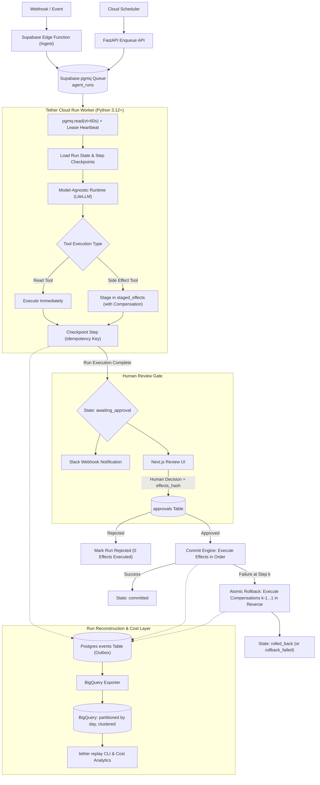

# Tether - Execution Layer: Project Roadmap & Architecture Plan

Tether is a durable, event-triggered, model-agnostic agent runtime on Supabase and GCP with a human review gate, atomic rollback, and full run reconstruction.

---

## Architecture Blueprint

---

## Detailed Sections & Task Breakdown

### Section 1: Foundation, Core Configuration & ADRs (Phase 0 Skeleton)
- **Task 1.1**: Repository structure, `pyproject.toml` (uv/pip), Dockerfile, `.gitignore`, `.env.example`, and base `README.md`.
- **Task 1.2**: Architecture Decision Records (ADRs):
  - `ADR 001`: Custom loop vs Agent Framework (LiteLLM headless vs LangChain/CrewAI/LlamaIndex).
  - `ADR 002`: Queue Selection (`pgmq` on Postgres vs Redis/SQS/Celery) & `SKIP LOCKED` fallback strategy.
  - `ADR 003`: Compensation-Based Rollback Model & External System Non-Atomicity.
  - `ADR 004`: Outbox Pattern for Run Reconstruction & Warehouse Logging.

### Section 2: Database Schema, Migrations, State Machine & Core Models (Phase 1)
- **Task 2.1**: Supabase / PostgreSQL SQL migrations:
  - Tables: `runs`, `steps`, `staged_effects`, `approvals`, `events`.
  - pgmq queue initialization (`agent_runs` + DLQ `agent_runs_dlq`).
  - Stored procedures / atomic transactional `enqueue` function.
  - Row Level Security (RLS) policies for reviewer portal vs worker service role.
  - `SKIP LOCKED` fallback engine if pgmq is not installed.
- **Task 2.2**: Python Core Data Models & State Machine:
  - Pydantic v2 domain schemas (`Run`, `Step`, `StagedEffect`, `Approval`, `Event`).
  - Strict Finite State Machine (`queued` -> `running` -> `awaiting_approval` -> `approved` -> `committing` -> `committed` / `rolling_back` -> `rolled_back` / `failed` / `dead_lettered`).
  - Database repository & connection management layer (`psycopg 3` pool).

### Section 3: Model-Agnostic Runtime, Cost Attribution & Tool Staging (Phases 5 & 6)
- **Task 3.1**: Model-Agnostic `Runtime` Interface & LiteLLM Adapter:
  - `Runtime(Protocol)` with `complete(messages, tools, *, model, run_id, step_id) -> Completion`.
  - LiteLLM runtime with model fallback, latency tracking, token usage, timeout handling.
  - Cost tracking engine (`cost.py`) with price table per model.
- **Task 3.2**: Tool Execution vs Staged Effects Engine (`effects.py`):
  - Read tools (executed immediately) vs Effect tools (staged with compensation, never executed immediately).
  - Staged effects hashing (`effects_hash`), idempotency keys, and parameter serialization.

### Section 4: Step Engine, Durable State & Worker Lease Engine (Phases 3 & 4)
- **Task 4.1**: Step Execution Engine (`engine.py`):
  - Checkpointing every step before & after execution with idempotency key (`run_id` + `idx` + `hash(input)`).
  - Deterministic replay & resume skipping already executed steps.
  - Safe error trapping and run failure recovery.
- **Task 4.2**: Worker Lease & Poll Loop (`worker.py`):
  - `pgmq` lease read with visibility timeout and heartbeat extension loop.
  - Dead-letter queue (DLQ) routing after max attempts.
  - Graceful worker shutdown and signal trapping.
- **Task 4.3**: Enqueue & Health FastAPI Service (`api.py`):
  - REST endpoints: `POST /runs`, `GET /health`, `GET /runs/{id}`, `POST /webhook`.
  - Ingest payload normalization and event deduplication.

### Section 5: Human Review Gate, Commit Phase & Atomic Rollback (Phases 7 & 8)
- **Task 5.1**: Human Review Gate Engine (`gate.py`):
  - Transition to `awaiting_approval`, Slack notification webhook payload with action links.
  - Cryptographic verification of `effects_hash` before any execution can commence.
  - Approval & rejection handler, lease expiration and release mechanism.
- **Task 5.2**: Commit & Compensation Rollback Engine (`effects.py` execution phase):
  - Sequential execution of approved staged effects using idempotency keys.
  - Automatic unwind / reverse compensation on failure of effect $k$ ($k-1 \dots 1$).
  - `rollback_failed` alerting, audit logging, and human intervention logs.

### Section 6: Warehouse Event Outbox, BigQuery Exporter & Replay CLI (Phases 9 & 10)
- **Task 6.1**: Outbox Event Emitter & BigQuery Exporter (`events.py`, `export.py`):
  - Structured event schema (prompts, tool calls, state changes, costs).
  - Redaction engine for PII and sensitive secrets before warehouse load.
  - Postgres outbox to BigQuery batch loader with daily partitioning and clustering.
- **Task 6.2**: Run Reconstruction CLI (`replay.py`):
  - `tether replay <RUN_ID>`: Reconstructs timeline solely from warehouse logs.
  - `tether replay --diff <RUN_A> <RUN_B>`: Side-by-side comparative replay.

### Section 7: Review UI & Edge Ingest Function (Phases 2 & 7)
- **Task 7.1**: Supabase Edge Function (`supabase/functions/ingest/`):
  - TypeScript / Deno webhook receiver with signature validation, payload mapping, and event deduplication.
- **Task 7.2**: Review Portal Web App (`review-ui/`):
  - Next.js application with dark mode / premium UI.
  - Real-time review view: agent details, trigger, prompt history, staged effects diff, approval/rejection with reason.

### Section 8: Infrastructure as Code (Terraform) & CI/CD (Phases 0 & 11)
- **Task 8.1**: Terraform Modules (`infra/`):
  - GCP Cloud Run service (worker + API), Cloud Scheduler (cron triggers).
  - BigQuery dataset and partitioned tables.
  - IAM least-privilege service accounts & Secret Manager.
  - GCP Budget alerts and Cloud Monitoring alerts.
- **Task 8.2**: GitHub Actions CI/CD (`.github/workflows/`):
  - Test & lint pipeline, Terraform validation, Docker build & Cloud Run deployment workflow.

### Section 9: Chaos & Reliability Testing Suite & Demo Agent (Phases 9 & Demo)
- **Task 9.1**: Demo Agent Implementation (`agents/demo_digest.py`):
  - Concrete real-world triage/digest agent testing the entire runtime.
- **Task 9.2**: Unit, Integration & Chaos Test Suite (`tests/`):
  - Test 1: Forced worker kill (`kill -9`) mid-run & recovery without duplicating side effects.
  - Test 2: Webhook redelivery / duplicate event idempotency.
  - Test 3: Model call timeout / fallback model failover.
  - Test 4: Human rejection test (zero effects executed).
  - Test 5: Effect hash tampering / mismatch prevention.
  - Test 6: Crash mid-commit & compensation unwind in reverse.
  - Test 7: Poison message DLQ transition after $N$ attempts.
- **Task 9.3**: Chaos runner script & verification documentation.

---

## Execution Protocol per User Request
1. Execute one task at a time.
2. Run validation tests and sanity checks.
3. Commit the changes cleanly with a descriptive message.
4. Push to remote `origin main` (`https://github.com/Harsh-karn/Event-Driven-Agent-Runtime-with-Human-Review-Gate-and-Atomic-Rollback.git`).
5. Review progress and confirm before moving to the next task.
